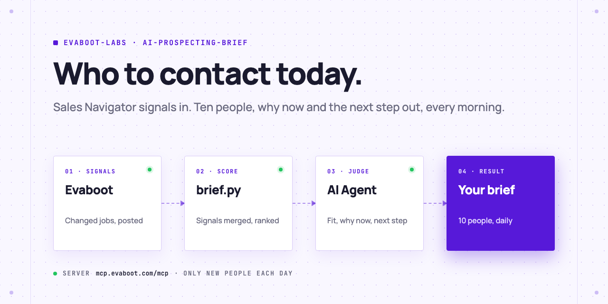
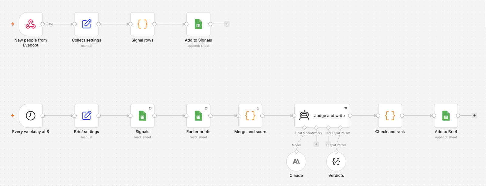

<picture>
  <source media="(prefers-color-scheme: dark)" srcset=".github/assets/banner-dark.png">
  
</picture>

# AI prospecting brief

Every morning, your AI Agent takes the new people from your Sales Navigator signal searches (changed jobs, posted on LinkedIn), scores their signals, judges who fits, and writes a short brief: who to contact today, why now, and the next step. You do the outreach.

[](AGENTS.md)
[](https://evaboot.com/mcp)
[](LICENSE)

## Set it up in one prompt

Paste this into Claude Code, Codex or Cursor:

```text
Clone https://github.com/evaboot-labs/ai-prospecting-brief, read AGENTS.md and follow the skill. Set up my daily prospecting brief.
```

<details>
<summary>Or install the skill</summary>

Claude Code:

```text
/plugin marketplace add evaboot-labs/ai-prospecting-brief
/plugin install ai-prospecting-brief@evaboot-labs-ai-prospecting-brief
```

Codex, Cursor and other agents:

```bash
npx skills add evaboot-labs/ai-prospecting-brief
```

</details>

## How it works

**1. One search per signal, on the same buyers.** Your agent asks who you sell to, writes it into [`SIGNALS.md`](SIGNALS.md), and builds two Sales Navigator searches with Evaboot: people who changed jobs in the last 90 days, and people who posted on LinkedIn in the last 30 days.

**2. The signals are merged and scored.** Someone found by both searches outranks someone found by one. Their own data adds more: under 3 months in the role, company growth of 30% or more, a verified email.

```text
$ python3 brief.py facts --signal changed_jobs=data/jobs.json --signal posted=data/posts.json > queue/leads.json
26 new people, 4 found by more than one search
```

**3. Your agent judges each one and writes the brief.** Fit or not, one line on why now, and one next step: email, LinkedIn, call or watch. `brief.py check` rejects a verdict with no reason, a reason over 30 words, a missing action, or an email step without a verified email.

Two rows of a real brief, with the people and companies left out:

| # | Who | Signals | Why now | Next step |
|---|---|---|---|---|
| 1 | Head of Revenue Operations at an AI software company (51-200) | changed jobs, company +105% in a year, under 3 months in role, posted on LinkedIn | One month into the role, at a company that doubled in a year, with a 14-person sales team. | **email**: open on the new role and offer clean Sales Navigator lists for the reps. |
| 9 | VP of Revenue Operations at a sales software company (51-200) | company +170% in a year, posted on LinkedIn | Fast growth and a recent post, but the email is only "riskier". | **linkedin**: connect with a note on the growth first. |

**4. Every day, only new people.** A daily recurring export repeats each search and returns only the people who are new to it. Nobody shows up in the brief twice.

**5. Or run it in n8n.** Evaboot sends each day's new people to a webhook, and every weekday at 8 Claude writes the brief into a Google Sheet.



## What you need

- An [Evaboot account](https://dash.evaboot.com/accounts/signup/?last_click_origin=ai-prospecting-brief-repo) and a Sales Navigator seat.
- An AI Agent that can use an MCP server: Claude Code, Codex, Cursor, or the n8n version.
- Python 3.9+, with no packages to install.
- Cost: previews are free; 1 Evaboot credit per exported lead, and each daily run only exports the new people.

## Go further

| Page | For |
|---|---|
| [docs/connect-your-agent.md](docs/connect-your-agent.md) | The setup by hand, for each agent |
| [docs/n8n.md](docs/n8n.md) | The same brief in n8n, into a Google Sheet |
| [SIGNALS.md](SIGNALS.md) | Who you sell to, the signal searches, and the brief rules |

---

Agents: start at [AGENTS.md](AGENTS.md) · Built by [Evaboot](https://evaboot.com) · More workflows at [github.com/evaboot-labs](https://github.com/evaboot-labs) · [MIT license](LICENSE)
